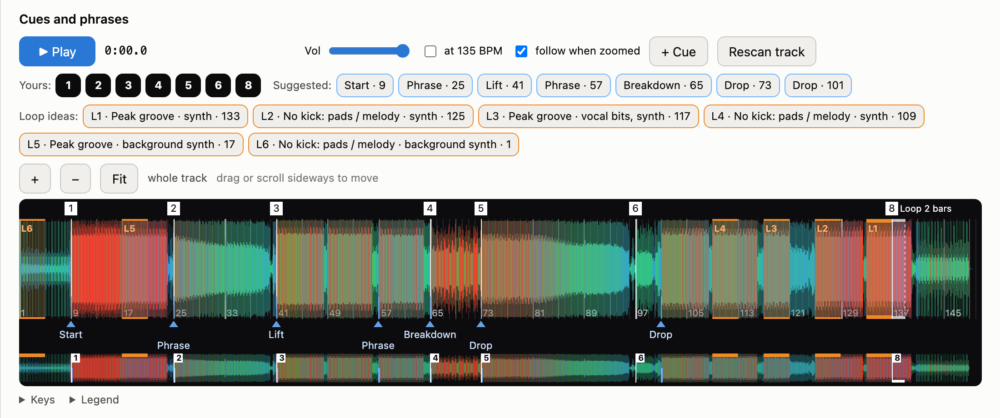
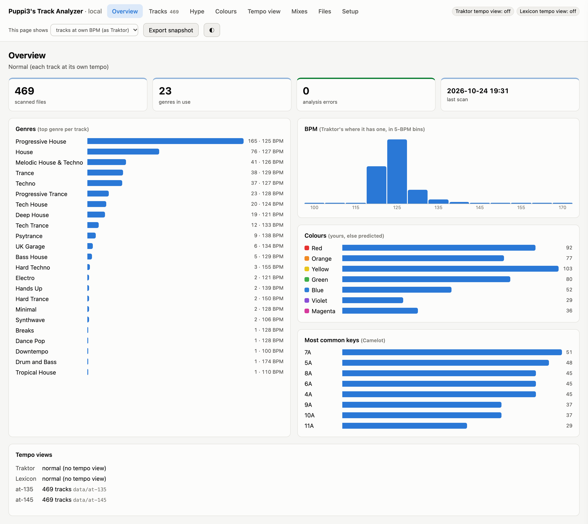
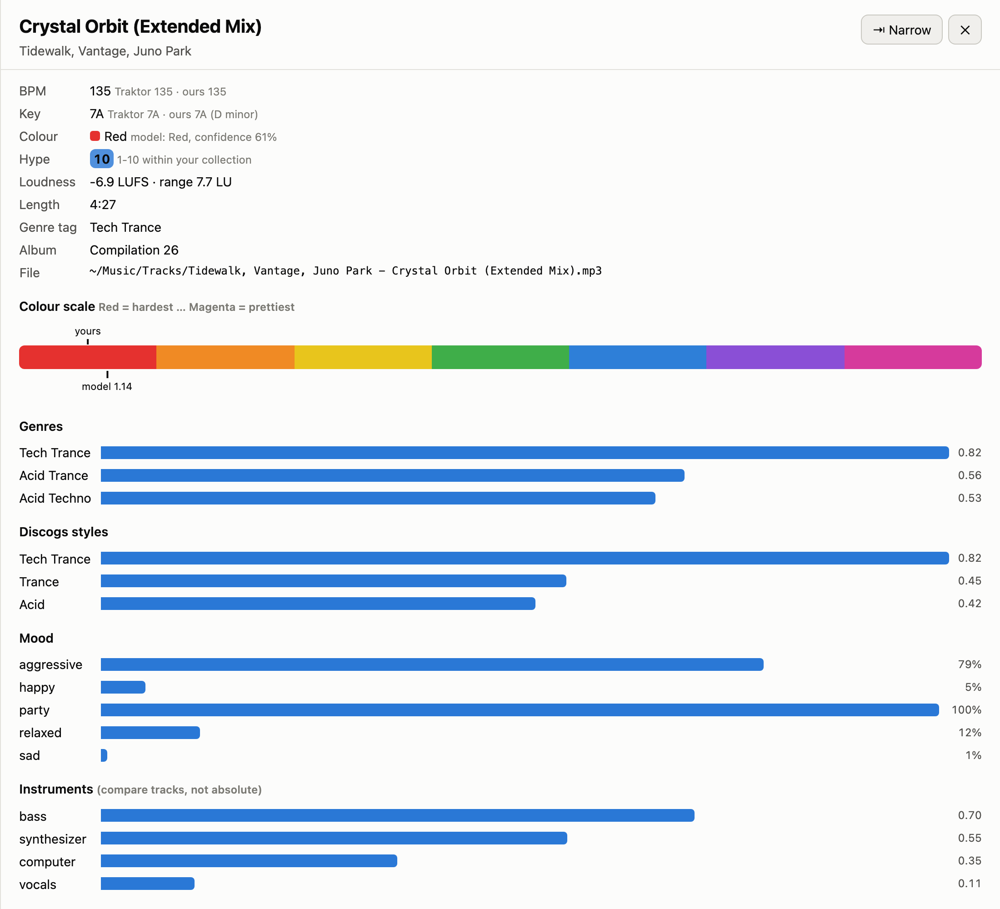

# Puppi3's Track Analyzer

Local music analysis for a DJ's Mac (or Linux computer): BPM, key, subgenre, mood, your own Traktor colour scale and a hype score, synced into **Traktor Pro 4** (and optionally Lexicon), plus an MCP server so a local LLM can search your collection. Fully offline, no length limit, free.

> **Already installed?** Day-to-day use is in the **[guide](https://puppi3-music.github.io/puppi3s-dj-tools/track-analyzer/)** (also in the project as `docs/GUIDE.html`): each task in the web page step by step, how to read it, how to undo, and every command in its own section. This README is the full reference.

<picture>
  <source media="(prefers-color-scheme: dark)" srcset="docs/img/cues-dark.png">
  
</picture>

*One track in the web page: your hot cues on Traktor's beat grid, the cues and mix loops the analyzer suggests (learned from where you put yours), and loop ideas named by what plays in them. Every pad plays from the page.*

## What you get

For every MP3, WAV, FLAC, AIFF or M4A:

| | |
|---|---|
| **BPM** | A whole number, folded into 85–220 (a 170 BPM track heard as 85 is reported as 170). |
| **Key** | Key name plus **Camelot** code (8A, 11B, …), the wheel DJs use for harmonic mixing. |
| **Loudness** | Integrated **LUFS** (overall loudness), loudness range, and an energy curve through the track. |
| **DJ subgenre** | 42 DJ genres (Acid Trance, Hard Trance, Progressive Trance, Techno, Melodic House & Techno, Psytrance, …), top 3 with scores. No training needed. |
| **Discogs styles** | The raw top 5 of the 400 styles the genre models know. |
| **Mood, instruments, vocals** | Aggressive / happy / party / relaxed / sad, the strongest instruments, and how much of the track has a voice. |
| **Colour** | A Traktor colour for uncoloured tracks, learned from the tracks you've already coloured (Traktor's 7 colours read as a scale, Red … Magenta). |
| **Hype** | 1–10 within your collection, from the rave sound and energy. |
| **DJ mixes** | Files over 12 minutes get a timeline in 2-minute segments. With `--tracklist`, a recorded mix is checked track by track against Traktor's history of that session. |

When a track is in your Traktor collection, Traktor's own BPM and key are stored too, and they win for search, mix suggestions, hype filters and tag writes (you may have fixed the beatgrid by hand).

## Contents

1. [Install](#1-install-one-time)
2. [Scan your collection](#2-scan-your-collection)
3. [Genres in your files and in Traktor](#3-genres-in-your-files-and-in-traktor)
4. [Colours: learned from your colour-coding](#4-colours-learned-from-your-colour-coding)
5. [Hype (1–10)](#5-hype-110)
6. [Your catalogue at your play tempo](#6-your-catalogue-at-your-play-tempo-tempo-view)
7. [How the analysis works](#7-how-the-analysis-works)
8. [Ask a local LLM](#8-ask-a-local-llm-lm-studio-open-webui)
9. [Optional: train your own genres](#9-optional-train-your-own-genres)
10. [All commands](#10-all-commands) · [Settings](#settings) · [Project layout](#project-layout) · [Good to know](#good-to-know)

Every command runs from the project folder and starts with `uv run dj-track-analyzer` (it used to be `uv run server.py`; see [Project layout](#project-layout)). Anything that changes your files or Traktor has a `--dry-run` that shows what would happen and changes nothing.

---

## 1. Install (one time)

### The easy way: no Terminal (Mac)

On Linux, see [Linux](#linux) below: the same launcher runs from a terminal.

1. Download or clone this project and open its folder in Finder.
2. Double-click **`Start Puppi3's Track Analyzer.command`**. The first time, macOS may say it's from an unidentified developer: right-click it, choose **Open**, then **Open** again.
3. A Terminal window opens and does the install for you: it installs **uv** (the Python manager, from astral.sh) if it's missing, then Python and the analyzer (about 400 MB, a few minutes the first time). Then the web page opens in your browser.
4. The page starts on its **Setup** tab: a checklist that downloads the models, scans your Traktor collection or a music folder, learns your colours and cue points, installs ffmpeg and rubberband (with Homebrew, if you have it) and puts the results into your files and Traktor. Each button runs the same command as below, in the background, with a progress bar and a live log; **Stop** is safe (scans carry on where they stopped next time).

Keep the Terminal window open while you use the page; close it to stop. Double-click again any time: if the page is already running, it just opens it.

### The Terminal way

Open **Terminal**:

```bash
# 1. Install uv (Python manager). Skip if `uv --version` already works.
curl -LsSf https://astral.sh/uv/install.sh | sh
#    then close and reopen Terminal

# 2. Go to the project folder (wherever you cloned or unpacked it)
cd ~/puppi3s-dj-tools/track-analyzer

# 3. Install everything: Python 3.11 + Essentia, about 400 MB
uv sync

# 4. Download the models: a few hundred MB, mostly MAEST
uv run dj-track-analyzer setup              # --no-maest: smaller, EffNet-only genres

# 5. Only for the tempo view (section 6)
brew install rubberband                     # Linux: sudo apt install rubberband-cli (3.0 or newer)
```

Test it on a track:

```bash
uv run dj-track-analyzer analyze ~/Music/some-track.mp3
```

Under `genre_basis` it should say `"models": "EffNet + MAEST"`. If it says only `EffNet`, the reason is next to it under `maest`.

- **Model server unreachable?** `setup` tries a few ways, then prints a download link for each file it couldn't get. Open them in a browser, drop the files into `data/models/`, and run `setup` again to confirm.
- **Speed.** The first run takes a few extra seconds while TensorFlow loads; after that a typical track takes about 10–15 seconds on an M1 Pro Mac (MAEST is about half of that).
- **Requirements.** Apple Silicon with macOS 11 or newer, an Intel Mac with macOS 14 or newer, or Linux on x86_64 (see below). Not Windows yet: [docs/WINDOWS.md](docs/WINDOWS.md) lists what a port needs.
- **Faster loudness, resampling and model input.** The install includes a small prebuilt module (`track-analyzer-dsp`, downloaded from this repo's GitHub releases) that does loudness and resampling 5–7 times faster and the models' mel input faster too (EffNet 1.2–1.8x), with exactly Essentia's results. Nothing to set up; no Rust needed.
- **Faster decoding (optional).** `uv sync --extra decode` adds PyAV (current FFmpeg), which reads audio files with
  exactly Essentia's samples, 1.15x faster for MP3 and 2.4x for FLAC, using a third of the memory on long mixes. It needs
  macOS 14 or newer on Apple Silicon. A plain `uv sync` removes it again (`Start Puppi3's Track Analyzer.command` runs
  `uv sync --inexact`, which keeps it).
- **Vocals and synths in loop ideas (optional).** `uv sync --inexact --extra stems` adds Demucs (PyTorch, about 600 MB),
  which separates each loop idea into drums, bass, synths and vocals, so the loop buttons say "vocals", "vocal bits",
  "synth", "no bass" or "drums + bass only", and whether a loop has a kick comes from the drum stem (no bassline in the
  way, so it hears quiet and filtered kicks the full-mix measurement misses). It runs when you open a track (about 8 seconds on Apple Silicon, then cached), only
  on the loops. Male / female isn't detected: no model tried could tell them apart in club tracks.

### Linux

Everything that works on your music files works on Linux (x86_64 only; Essentia has no Linux ARM build): scanning, BPM, key, genres, moods, hype, tags, search, mix checks, clips, the tempo view, the web page and the MCP server. Traktor doesn't run on Linux, so the steps that read or write Traktor's collection don't apply: `traktor`, `scan --traktor` (scan your folders instead), colours, cue points, `tempo load` / `native` / `nml`, `hype --traktor`, `analyze --tracklist` and `--chapters`, and Lexicon (`--lexicon`). `hype --gems` needs Traktor's stars and play counts, so it finds nothing. Without Traktor, scans use the analyzer's own BPM and key.

Install the same way, from a terminal: `./"Start Puppi3's Track Analyzer.command"` (it opens the page with `xdg-open`), or the Terminal steps above. Install the tools with your package manager, for example `sudo apt install ffmpeg rubberband-cli`. The tempo view needs Rubber Band 3.0 or newer (Ubuntu 24.04 and Debian 12 have it; Ubuntu 22.04's 2.0 is too old). A drive that isn't plugged in (under `/media`, `/run/media` or `/mnt`) keeps its tracks in the database, as on a Mac.

### Checking a recorded mix

```bash
uv run dj-track-analyzer analyze ~/path/Recording_2026-01-31_22h00m00s.wav --tracklist
```

Traktor saves a history file for every session (`Documents/Native Instruments/Traktor x/History/`): each
track played, on which deck, when it started. Its own recordings are named after the time they started, so
`--tracklist` finds the right history file and places each track in the recording. For a recording with
another name add `--start 22:00:00`; to use a particular history file, pass its path after `--tracklist`.
If no history file covers the recording, it says so: Traktor writes the file when it closes.

After the JSON, a mix gets a readable summary (genre, tempo, loudness, mood, key lock, a table of the tracks
with their keys and genres, and the timeline's genres); `--json-only` leaves it out. In the JSON, under
`tracklist`, per track:

- **Key:** Traktor's key against the key heard in the middle of the track's main stretch (from its start to
  the next track's start). Long blends and effects are normal, so the tool measures how long after Traktor
  logs a start a track takes over (`blend_lag_seconds`) as the delay at which most keys match. A mismatch
  can still be the other deck; a track with under 30 s of its own gets no verdict.
- **Key lock:** history files don't record it. It's taken as on, unless the keys fit the pitch-shifted
  keys (key lock off) clearly better.
- **Tempo:** the track's own BPM, the BPM it was played at and the change (`speed`).
- **Genre:** how the mix sounds as played, at the BPM you played it: speeding a track up and your mixing
  (stems, layers, effects) both really change it, and both count. Only one thing is held back: sped up, the
  models hear psytrance in almost any four-on-the-floor (a pop track at 145 gets called psytrance). As in the
  tempo view (section 6), psy counts only up to 1.5× what each track had at its own tempo, so scan the tracks
  first. With a tempo view near the mix's tempo (`tempo scan`), `mixing` lists the styles your mixing pushed
  up or down against each track alone at that tempo (part of that can be the other deck still playing).
  The label without the psy limit is kept as `dj_genre_uncorrected` (also per track and timeline segment),
  and the library's genre per track as `library_genre`.

**Posting the mix as a video:** `--chapters --offset 0:14` prints YouTube chapters for a video where the
first track starts 0:14 in. Read that off the finished video itself: it depends on how you lined the audio
up, so it can't come from the recording. The video's opening becomes an "Intro" chapter at 0:00, and very
short plays fold into the next chapter (YouTube wants at least three, 10 s apart). `--highlights` suggests
two 40-second stretches for short clips (`--highlights 5` for five; loud, rising out of something quieter;
loudness only, so pick by eye and snap to a bar), in video times with `--offset`, each ranked (#1 best). Trimming silence off the audio file doesn't change
the times: they're counted from the first track's start.

**Clips from the video:** `clips <analysis>.json --video final.mp4` cuts quick 720p previews of every
suggestion into `/tmp/clip-previews/<analysis name>/` so you can watch and choose. While cutting, it measures
how much moves on screen in each and ranks them by the audio and the movement together (files start with that
rank, e.g. `#1 clip-1 7m37s.mp4`): the audio can't see a stretch where the DJ stands still. On a test set the
audio's second pick was one of the stillest stretches of the whole video and dropped to fourth. Then `--pick 1 4` (suggestion numbers, or your own ranges like `20:30-21:10`) makes those clips at
full quality next to the video, named by suggestion number (`<video>-clip-1.mp4`, `-clip-4.mp4`; own ranges as `-clip-20m30s-21m10s.mp4`) (1440p30 H.264; hardware encoder on a Mac, software elsewhere;
`--height`, `--bitrate 16M`, `--out`). The JSON must come from `analyze` with `--highlights` and `--offset`.
Needs ffmpeg (`brew install ffmpeg`; Linux: `sudo apt install ffmpeg`). Existing clips are never overwritten without `--force`; `--dry-run` lists them.

On a test mix of 22 house and melodic techno tracks, all sped up 12-20% with stems layered, 12 keys matched
Traktor's and 1 was one step away. Without the tracklist the mix was called Psytrance (0.59); with it, Trance,
Tech Trance and Psytrance at 0.13-0.16 each: a trance blend, with psy only where the tracks already leaned that way.

---

## 2. Scan your collection

```bash
uv run dj-track-analyzer scan --traktor            # every track in your Traktor collection
uv run dj-track-analyzer scan ~/Music/Incoming     # folders (and their subfolders)
uv run dj-track-analyzer scan --traktor ~/Music/Incoming   # both
```

`--traktor` reads Traktor's `collection.nml` and analyses exactly the tracks Traktor knows, wherever they're stored. It lists tracks Traktor knows but whose files are missing (moved, or on a disconnected drive).

**Skipped automatically:** Traktor's bundled samples, your Traktor recordings and sample/loop folders (read from Traktor's settings, so custom locations count), hidden folders and macOS `._` files.

- **Resumable.** Ctrl-C any time and run the same command again. Later runs only analyse new or changed files and drop deleted ones. Tag edits (by this app or another tagger) don't count as changes.
- **Parallel.** About half your CPU cores, at most 5 workers. Each holds the models in memory (1.5–2.5 GB with MAEST), so 32 GB is plenty.
- **Time.** About 20 seconds per track per worker; on an M1 Pro, 470 tracks took 33 minutes with 5 workers.

| Option | What it does | Default |
|---|---|---|
| `--traktor` | Scan every track in Traktor's collection | off |
| `--nml <path>` | Use another `collection.nml` | newest `~/Documents/Native Instruments/Traktor */` |
| `--exclude <folder>` | Leave a folder out; repeat for several. Earlier results from it are removed | none |
| `--include-recordings` | Also scan your Traktor recordings and samples | off |
| `--workers N` | Parallel analysers | half your cores, max 5 |
| `--rescan` | Analyse everything again, even unchanged files (slow; some updates need it) | off |
| `--write-tags genre` | Tag the files right after scanning (same fields as `tag --fields`) | off |
| `--csv <file>` | Write the spreadsheet somewhere else | `data/collection.csv` |

**Results:**
- `data/collection.csv`, a spreadsheet for Numbers or Excel (column guide in [the guide](https://puppi3-music.github.io/puppi3s-dj-tools/track-analyzer/#results)). Write it again any time with `uv run dj-track-analyzer export [file]`.
- A database that the hype, colour and LLM tools read.
- `uv run dj-track-analyzer stats`: tracks per genre with average BPM, common keys, a BPM histogram, tracks per colour.

### Browse it all in a web page

```bash
uv run dj-track-analyzer web
```

Opens `http://127.0.0.1:8766/` in your browser (double-clicking `Start Puppi3's Track Analyzer.command` on a Mac does the same). Eight tabs:

- **Overview**: the `stats` numbers as charts. Click a bar, column or tile to list those tracks.
- **Tracks**: a searchable, sortable list. Click a track for its genres, styles, moods, instruments and place on your colour scale, plus what mixes well with it. A dimmed key in brackets, like 5A (8B), is the key the analyzer heard, shown only when it disagrees with Traktor's (hover for both); the filter **Our key doesn't mix with Traktor's** lists the tracks where the two keys don't mix, to check by ear. **⇤ Wide** widens the panel for the waveform and cues.
- **Hype**: the hype finder.
- **Colours**: the `colors review` and `colors explain` results.
- **Tempo view**: the `tempo report` results.
- **Mixes**: saved `analyze` results of recorded mixes, with the timeline, tracklist check, clip suggestions and chapters.
- **Files**: any other saved JSON.
- **Setup**: what's done and what's next, with a button for each step (below).

The **This page shows** menu switches the page between your normal library and a tempo view; it changes only the page. The **Traktor tempo view** and **Lexicon tempo view** labels beside it (Lexicon only if you use it) say what is loaded there right now, on every tab, and update when you come back to the page after a `tempo load` or `native` in a terminal. Browsing changes nothing; the page only writes when you press a button that says so (holds, cue approvals, saved samples, and the writers on the Setup tab), and anything that changes your files or Traktor shows a preview first. In a tempo view, colours show as `tempo load` puts them into Traktor (your colour moved by how the track sounds at that tempo; the track's panel also shows yours at its own tempo). Hype comes from the last scan, and `colors explain` leaves out tracks that haven't had the deep listening pass yet. The page runs only on this computer. Stop it with Ctrl-C.

<picture>
  <source media="(prefers-color-scheme: dark)" srcset="docs/img/overview-dark.png">
  
</picture>

*Overview: the whole collection by genre, BPM, colour and key. Click any bar to list those tracks.*

<picture>
  <source media="(prefers-color-scheme: dark)" srcset="docs/img/track-dark.png">
  
</picture>

*A track's panel: Traktor's BPM and key next to the analyzer's, your colour next to the model's, hype, and what the models hear: genres, Discogs styles, moods, instruments.*

**Setup tab: everything without a terminal.** A checklist from a fresh install to everything in Traktor: download the models, scan (your Traktor collection, a folder, or both), score hype, learn your colours and cue points, install ffmpeg and rubberband with Homebrew (without Homebrew, on Linux for example, it shows the command to run), scan a tempo view, check the beat grids. It shows what's done (models, how many Traktor tracks aren't scanned yet, files changed on disk since the scan, trained models with their dates) and what each step needs (for example 30 coloured tracks for the colour model). A button starts the step's command in the background, one at a time: a progress bar and the live log show on the page and in a bar at the top of every tab, and **Stop** works like Ctrl-C (scans keep what's done). The command is shown, so you can run the same thing in a terminal later. Stopping the web page stops a running step too.

The writers are there too, each with **Preview…** first (the command's `--dry-run`: counts and examples of what would change), then **Write it**, then **Undo**:

| Button | Same as | Undo |
|---|---|---|
| Genre tags in your files | `tag` (`--multi` when "close runner-up genres" is ticked) | `untag` |
| Genres, colours and Smartlists in Traktor | `traktor` (`--no-colors` when "colours too" is off) | `traktor --undo` |
| Hype in Traktor's Comment 2 | `hype --traktor` | `traktor --undo`, or **Take it out…** (`hype --traktor --remove`) |
| Colour new tracks | `colors apply` | `traktor --undo` |
| Recolour clear disagreements | `colors review --apply --yes` (also on the Colours tab) | `traktor --undo` |
| Load into Traktor (tempo view) | `tempo load` (`--lexicon` when ticked; also on the Tempo view tab) | `tempo native` |
| Undo the last change to Traktor | `traktor --undo` (refuses if Traktor saved since; no `--force` from the page) | |

The Traktor writers refuse while Traktor is open, exactly as in a terminal; the preview says so and offers **Check again**. The Hype tab has the Comment 2 button as well.

**Hold a track's genre or colour.** In **Tracks**, tick tracks (the header box ticks every track shown) and choose **Hold genre** or **Hold colour**, or use the switches in a track's panel. A held genre or colour stays as it is in your files, Traktor and Lexicon: `tag`, `scan --write-tags`, `traktor` (also with `--overwrite-colors`), `colors review --apply` and `tempo load` skip it and count it as `genre_held` / `colour_held`. Holding writes nothing at the time; it only changes the analyzer's own list. Release a track the same way. The colour hold is the same list as `colors review`'s "keep always". From a terminal:

```bash
uv run dj-track-analyzer hold                                # list held tracks
uv run dj-track-analyzer hold --genre "Artist - Title"       # hold the genre of tracks whose path contains this
uv run dj-track-analyzer hold --colour "Title" --release     # take one off the colour hold list
```

**Cue points and a mix loop, learned from yours.** The analyzer can learn where you put cues: it measures every bar on Traktor's own beat grid (loudness, bass, kick, brightness, timbre) and learns from the tracks you cued yourself which bars you cue and where you put your mix loop. Each track's panel in the web page then shows its waveform (coloured like DJ software: lows red, mids green, highs blue, ticks every 8 bars) with your cues on top and the suggestions below, named by what happens there (Intro, Drop, Breakdown, Kick in, Bass in, Lift, Outro, Phrase), plus a suggested loop. Zoom in (+, pinch or ctrl+scroll) down to a single beat: close in, the waveform is cut from the audio at the screen's own resolution, down to single samples.

```bash
uv run dj-track-analyzer cues train            # learn from your cues (listens to the cued tracks first, ~13 min once)
uv run dj-track-analyzer cues scan             # listen to the other tracks with a beat grid too
uv run dj-track-analyzer cues show "Title"     # suggestions for one track, next to yours
```

**Loop ideas.** Each track gets up to 6 loops (L1-L6, in your most common loop length): the two most like where you put your own loops, two peak-energy loops (the cleanest-looping stretches within 1.5 dB of the track's loudest, kick playing, outside the first and last 15% of the track where DJ intros and outros sit; looser when too few qualify), then the stretches that loop most cleanly anywhere in the track (bars that sound alike at a steady level, starting on the bar grid chosen in training, at least 8 bars apart), each described by its sound (Peak groove, Lighter groove, No kick: pads / melody, very steady). On the test collection the DJ's own loop was within 4 bars of one of the five ideas other than the peak ones 70% of the time (one suggestion alone: 34%). Each has a pad that plays it looped, a tick box to approve it as a loop cue, a length menu (1-16 bars, as many as fit before the end), and **Save sample**: a WAV of exactly that loop (gapless, sample-identical to the track: source sample rate, the source's bit depth for lossless files, 32-bit float for MP3s, whose loud masters decode above full scale) in Traktor's sample folder, into a subfolder you pick (default `Track Analyzer loops`). Every loop gets the same tiny fades at its two ends that Traktor puts on its own captured samples (64 samples, about 1.5 ms): Traktor reads a little past the end of a looping sample, and a loop cut from a loud groove would click there. Otherwise the samples are the track's own, cut on Traktor's timeline (see **Listen**), so they start exactly on Traktor's beat. **smooth loop point** (off by default) fades the loop's last 5 ms into the audio just before its start, the way samplers do, so a sound ringing over the end isn't cut off with a click; it changes the loop pads too, so you can hear it before saving, and leaves every other sample exact (saved as "…, smooth"). A loop that's already saved (same track, start, length and smoothing, in any sample folder, found by the note each sample carries) isn't saved twice: it shows **✓ saved in** its folder instead. Files are never overwritten. **Open folder** and, after saving, **Show in Finder** (**Show in file manager** on Linux) take you to them. Needs ffmpeg.

**Listen.** Above the waveform is a small deck: ▶ Play, your hot cues 1-8 and every suggestion as pads (click to jump there and play; loops play looped), and a ▶ next to each item in the approve list (corrections get ▶ yours and ▶ there, which plays the bar picked in its list, to hear which bar the phrase starts on); while it plays it turns into ⏸, which stops it. Click the waveform to jump; Space plays/pauses, 1-8 hit your cues, ←/→ jump a bar, shift+←/→ a phrase (8 bars). Only files in your scanned library can be played, and only on this computer; a snapshot file has no audio. Everything in the page runs on Traktor's timeline: most MP3s start with a header frame and encoder padding that other decoders skip and Traktor plays (about 51 ms), so the player, the waveform and the cue measurements shift those files to match Traktor's beat grid exactly (checked against Traktor's own captures). The first play of such a track takes a few seconds while a matching copy is prepared. **at 145 BPM** (shown once you've scanned a tempo view; on by default while you browse one) plays the track as the view hears it: stretched with key lock by Rubber Band's R3 engine, from the tempo the view's scan stretched from. One Rubber Band uses one core (≈30 s for a track), so the player stretches 15 s pieces 8 at a time (each started 4 s early so the stretcher has settled, joined with a 30 ms crossfade): ≈6 s for a 4-minute track, started when you open it, then kept for the last few tracks. It sounds like the scan's whole-track stretch, though the samples differ. Cue pads, loops, the waveform and bar/beat stay on the track's own timeline, so switching mid-play carries on from the same beat. Saved samples stay at the track's own tempo.

**Approve and write them.** Under the waveform, tick the suggested cues and loop you want, and any proposed correction of your own cues (a yellow arrow: one of your cues the model would put 1-2 bars away, or onto the downbeat; judged by a model that never saw that track's cues, since some off-grid cues are on purpose). Each correction has a list of the other bars the model found for that cue (the bar before and after, nearby bars it scores well, the suggested cues, the downbeat of its own bar), each with its score; ★ marks the proposal, and picking one ticks the move. To move a cue that has no correction onto a suggestion, use **move my cue here…** next to that suggested cue: the move appears under **Your cues moved by hand**, ticked, where you can still pick another bar. **C** (or **+ Cue**) sets a new cue where the playhead is, on the nearest beat. Each new cue has a slot menu: **Auto** takes a free hot-cue slot, or pick one your cue holds and that cue and the ones after it move up a slot. With a free slot, a folded list under New cues offers more places for a new cue (lower scores, away from your cues and the suggestions). To delete one of your cues, loops or fade / load markers from Traktor, press the ✕ on its pad (or tick it under **Delete your cues**): its slot is left free. A volume slider on the deck sets the page's playback level only. **Approve ticked** only remembers your choice. Then quit Traktor and press **Write to Traktor…** (in the track's panel or at the top of the Tracks tab): it lists every new and moved cue across all approved tracks, and anything that won't fit, before writing anything, refuses while Traktor is open, makes a backup, and offers **Undo** afterwards (which also brings your approvals back). The same from a terminal:

```bash
uv run dj-track-analyzer cues apply --dry-run   # what would be added / moved
uv run dj-track-analyzer cues apply             # write it (backup; undo: traktor --undo)
```

Approved items move into a **✓ Approved** group and show as your cues everywhere (waveform, pads, keys 1-8: green = new, → = moved), as they'll be in Traktor; they no longer count as corrections. **Ignore** hides a correction you disagree with (Restore brings it back; it returns by itself only if the cue moves). **Rescan track** measures the track's audio again and re-reads its beat grid and cues from Traktor's collection, which Traktor saves when it quits.

New cues go only into free hot-cue slots (cue points in 1-7, the loop in slot 8 when free) and are skipped within a bar of one of your cues (one you set at the playhead only on the same spot). If your hot cues were in time order, they stay so: a new cue between your 3 and 4 becomes 4 and your 4, 5, 6 become 5, 6, 7 (loops keep their slots). Deleted cues go first, and nothing is renumbered for them; your own cues are only moved where you ticked a correction, and only if they're still where they were. A track whose beat grid changed after you approved is left alone. The Tracks filter **Cues approved, not written to Traktor yet** lists what's waiting.

`train` reports how often its suggestions land on the bars you cued, for tracks it never saw (cross-validated). On a test collection of about 470 tracks: 61% of suggested cues were on a bar the DJ cued, and 64% of their cues were found, against 29% / 35% for a cue every 16 bars. The loop landed within 4 bars of theirs 36% of the time. Needs at least 30 tracks with 3+ of your own cue points; train again after cueing more.

**Loop length.** The length menu starts on the length you'd likely give a loop there: `cues train` also learns your loop lengths (1, 2, 4 or 8 bars) from how cleanly the audio loops at each length where you put your own loops, and keeps that only if it picks your length more often than always using your most common one (on the test collection 54% against 45% for always 4 bars). Otherwise it's your most common length. Changing the length of an approved loop saves it straight away.

**Beat grids that sit on the kicks.** The cue suggestions, loops and samples all trust Traktor's beat grid, so the analyzer can check that grid: in up to six 8-bar stretches where the kick plays, it finds where the kick lands against the grid lines. Each track's panel shows the result under **Beat grid**: *on the kicks* (within a few ms), *kick +14 ms* (a grid off by 10 ms or more, the same all through the track), *BPM drifts* (the kick slides against the grid from start to end: Traktor's BPM is slightly off, which moving the grid can't fix; check it in Traktor) or *couldn't tell*. For a grid that's off, **▶ Click on the grid now** and **▶ Click on the moved grid** loop a few bars with a click on each grid line so you can hear which is right, the box sets how far to move it, **Approve** remembers it and **The grid is right** stops proposing it (until the grid changes). If the track has a stem file, the panel says whether the stem lines up with the track: Traktor uses one grid for both, so a stem that's off needs remaking first (a grid set on a stem made without the MP3's 51.2 ms lead-in is off by exactly that, and the fix is set to it). Then quit Traktor and press **Write grid fixes to Traktor…** (in the panel or at the top of the Tracks tab): it lists what moves, makes a backup, moves each approved grid together with every cue, loop and marker of that track (so they stay on the beat) and your approved cues for it, and offers **Undo**, which also brings back your approvals. The Tracks filter **Grid off the kicks or drifting** lists the tracks to look at. Checking takes about 3 minutes for 470 tracks the first time, then only new and changed grids:

```bash
uv run dj-track-analyzer grids check             # measure every track with a beat grid (cached)
uv run dj-track-analyzer grids show "Title"      # one track's reading, and whether its stem file lines up
uv run dj-track-analyzer grids apply --dry-run   # what the approved fixes would move
uv run dj-track-analyzer grids apply             # write them (Traktor closed; backup; undo: traktor --undo)
```

On the test collection 403 of 473 grids were on the kicks (median 0 ms), 62 off, 2 drifting and 6 unclear; 41 of the off ones had been set on stem files that left out the MP3 lead-in.

**Starter model.** Until you train your own, suggestions and loop ideas come from a starter model that ships with the app, learned from one DJ's hand-placed cues on that test collection (cues on 8-bar phrases, a 4-bar mix loop near the end). Run `cues scan` so it can hear your tracks. It doesn't propose corrections of your own cues; `cues train` replaces it.

**Share it.** **Export snapshot** (top right) saves the whole page as one HTML file, with the data inside: open it in any browser, offline, or send it to someone. It includes track names, file paths, playlists and play counts. A snapshot can't change anything, and mix suggestions in it use the default rule (same genre, BPM ±4%). From a terminal: `uv run dj-track-analyzer web --export set.html`.

The Mixes and Files tabs read `logs/`. Save a mix's analysis there with `analyze <mix> --tracklist --json-only > logs/<name>.json`, or drop a JSON file onto the page. Use `--logs <folder>` (repeatable) to read other folders, `--port` for another port and `--no-open` to keep the browser closed.

---

## 3. Genres in your files and in Traktor

### Write genres into the files' tags

Uses the saved scan; nothing is analysed again.

```bash
uv run dj-track-analyzer tag --multi --dry-run     # 1. preview "old genre → new genre", changes nothing
uv run dj-track-analyzer tag --multi               # 2. write the genre tag
```

| Option | What it does | Default |
|---|---|---|
| `tag <folder>` | Only files in that folder | everything scanned |
| `--multi` | Tracks between two genres get both: `Acid Trance; Hard Trance` | off |
| `--multi-ratio 0.7` | With `--multi`: a runner-up needs at least this share of the top score | 0.7 |
| `--max-genres 3` | With `--multi`: most genres per track | 3 |
| `--fields genre,bpm,camelot` | Also write BPM and key. Fields: `genre`, `bpm`, `key` (Am, F#…) or `camelot` (8A…), not both | `genre` |
| `--min-score 0.3` | Skip weak guesses (see `genre_score` in the CSV); those keep their current genre | 0 |
| `--use-my-genre` | Write your trained genres instead (section 9) | off |
| `--dry-run` | Preview the first 15 changes | off |

With `--multi`, clear-cut tracks keep one genre, and a runner-up that overlaps a chosen genre (Hard Trance + Trance) is left out so Smartlists can still tell them apart. **Navidrome** splits on `;`, lists the track under each genre, and picks the change up on its next library scan.

**Safety.** Before the first change to each file, its original genre, BPM and key tags are saved. Files that changed since they were scanned are skipped. Running `tag` again only touches files whose tags differ.

**Undo:**

```bash
uv run dj-track-analyzer untag --dry-run
uv run dj-track-analyzer untag                  # everything
uv run dj-track-analyzer untag ~/Music/X        # one folder
```

### Put genres into Traktor and build genre Smartlists

Traktor keeps its own copy of every track's tags in `collection.nml`, so new file tags don't reliably show up on their own. `traktor` edits the collection directly.

> **Quit Traktor first.** It rewrites the collection when it closes, which would undo the change, so the command refuses while Traktor is running.

```bash
uv run dj-track-analyzer traktor --dry-run         # preview
uv run dj-track-analyzer traktor                   # do it, then start Traktor
```

What it changes, and nothing else (cue points, beatgrids, play counts and your playlists stay byte-for-byte the same):
- **Genre** of every scanned track in the collection, set to the file's genre tag (so run `tag` first).
- **Colour** of tracks that have none yet, once you've trained a colour model (section 4). Colours you set are never changed.
- A playlist folder **Genres (Track Analyzer)** with one **Smartlist** (a saved search that updates itself) per genre, e.g. *Hard Trance* = Genre contains "Hard Trance". Only for this app's genre names and your trained ones; a shop tag like "melodic techno, indie dance" doesn't get a Smartlist. Names inside other names are handled: *Trance* excludes Acid/Hard/Tech/Progressive Trance and Psytrance, *Techno* excludes Acid/Hard/Dub/Industrial Techno and Melodic House & Techno, *Hardcore* excludes Happy Hardcore.

Each run recreates that folder, so keep customised copies of a Smartlist outside it.

| Option | What it does | Default |
|---|---|---|
| `--dry-run` | Preview only | off |
| `--undo` | Restore `collection.nml` from before the last run; run again to step back further | |
| `--undo --force` | Restore even though Traktor saved the collection since (loses what Traktor saved: plays, cues, edits) | |
| `--smartlists-only` / `--no-smartlists` | Only rebuild the Smartlists / only update genres | |
| `--no-colors` | Don't colour uncoloured tracks | |
| `--color-min-confidence 0.3` | Only colour the more reliable guesses | 0 |
| `--overwrite-colors` | Also replace colours you set yourself. Not recommended | off |
| `--nml <path>` | Another collection | newest Traktor folder |

Before every change it saves `collection.nml.before-track-analyzer-<date-time>` next to the collection, and it checks the result is valid before saving.

> **Tested with Traktor Pro 4.5:** Traktor opens and saves a collection edited this way, and the genre Smartlists show the right tracks.

### After editing `dj_genres.json`

```bash
uv run dj-track-analyzer regenre      # genres again from the saved scores, in seconds; updates the CSV
```

Your files and Traktor only change when you then run `tag --multi` and `traktor`.

---

## 4. Colours: learned from your colour-coding

If you colour-code tracks in Traktor, the app learns your system from the tracks you've already coloured and suggests colours for the rest. It reads Traktor's 7 colours as one ordered scale:

**Red** (1) → **Orange** → **Yellow** → **Green** → **Blue** → **Violet** → **Magenta** (7)

It works best when your colours mean something that runs in that order. The labels and the LLM tools assume Red = hardest/darkest and Magenta = softest/prettiest; the model itself just learns whatever order you use.

**Starter scale.** Until you train your own, the app uses a starter model that ships with it, learned from one DJ's colours on a test collection of about 470 tracks (Red = hard, heavy … Magenta = peaceful, pretty). Scans predict colours with it and `colors apply` can write them; `colors review` waits for your own model, since it compares your colours with what it learned from them. `colors train` replaces the starter for good (it stays in the app, unused).

```bash
uv run dj-track-analyzer scan --traktor           # 1. analyse your Traktor tracks
uv run dj-track-analyzer colors train             # 2. learn your scale (only reads Traktor's files)
```

`colors train`:
- **First run:** a "deep listening" pass over all scanned tracks: MAEST's inner representation (texture, atmosphere, melody) plus mood, instrument and vocal scores. Cached; later runs take about a minute.
- Tries several models and keeps the one with the lowest error *averaged per colour*, so Red and Magenta count as much as the crowded middle. All scores are measured on tracks the model didn't train on.
- Prints a colour-scale check (BPM, loudness, aggressiveness per colour), the instruments that change most from Red to Magenta, and the tracks whose sound disagrees most with your colour.

**How good is it?** That depends on how consistent your colours are and how much they follow the sound. On a test collection of about 470 house/techno/trance tracks (Red = hard … Magenta = pretty), it was off by **1.17 colours** on average (always guessing the middle colour: 1.63) and right or one step off **67%** of the time. Neighbouring colours were close to a coin flip from the sound alone; the two ends were clearly apart. `colors train` prints these numbers for your collection. Retrain whenever you've coloured more tracks.

After training, every scan predicts a `color`, a `position` (5.4 = Blue leaning Violet) and a `confidence`: how often tracks placed there really had that colour. Most tracks are 0.2–0.3.

### The colour commands

| Command | What it does | Traktor |
|---|---|---|
| `colors train` | Learn your scale (above) | can stay open |
| `colors apply` | Scan new Traktor tracks, predict their colours, colour only the uncoloured ones | **closed** (except `--dry-run`) |
| `colors review` | The tracks whose sound disagrees most with your colour, judged by a model that never saw that track's colour | can stay open |
| `colors review --apply` | Recolour only the clearest disagreements | **closed** (except `--dry-run`) |
| `colors explain` | What each colour means in your collection (below) | can stay open |
| `colors guessed` | The colours `apply` / `traktor` wrote that nobody has checked yet (below) | can stay open |

| Option | Works with | What it does | Default |
|---|---|---|---|
| `--dry-run` | `apply`, `review --apply` | Show which colours would be set | off |
| `--min-confidence` | `apply` / `review --apply` | Only set guesses at least this reliable | 0 / 0.75 |
| `--min-gap 2.5` | `review --apply` | How many colours away from yours a track must sound | 2.5 |
| `--yes` | `review --apply` | Recolour every qualifying track without asking about each one | off |
| `--kept` | `review` | List the tracks on your keep-always list | off |
| `--keep TEXT` | `review --kept` | Put the coloured tracks whose path contains TEXT on the keep-always list (10 matches at most) | — |
| `--forget TEXT` | `review --kept` | Take tracks whose path contains TEXT off the keep-always list | — |
| `--accept TEXT` | `guessed` | These guessed colours are right: the tracks whose path contains TEXT (10 at most), or `all` | — |
| `--workers N` | `train`, `explain`, `apply` | Parallel workers for the deep listening pass | half your cores, max 5 |
| `--no-deep` | `train` | Skip the MAEST/mood/instrument features (faster, less accurate) | off |
| `--json` | `explain` | Raw numbers instead of tables | off |
| `--nml <path>` | all | Another collection | newest Traktor folder |

`review --apply` asks about each track first (yes / no / keep always / all the rest / cancel). **Keep always** (`k`) keeps your colour and puts the track on a keep-always list, so `review --apply` never suggests it again; plain `review` still lists it, marked `kept`. See the list with `colors review --kept`, add tracks with `--keep "<part of the name>"`, and put one back in play with `--forget "<part of the name>"`. The list lives in the analyzer's database, not in Traktor. `--yes` skips the questions, and they're skipped anyway when the input isn't a terminal. It skips tracks you've recoloured since training. `apply` and `review --apply` make the same backup as `traktor`, so **undo** is `traktor --undo` (Traktor closed).

**What training learns from.** Every colour you set or accepted, whoever suggested it. A recolour you said yes to in `review --apply` counts as yours. A colour `apply` or `traktor` filled in (or replaced, with `--overwrite-colors`) is the model's own guess that nobody looked at, so `train` leaves it out: learning from its own guesses would only make the model surer of its mistakes. It counts once you change it in Traktor, or accept it: `colors guessed --accept "<part of the name>"` (or `all`), or on the Tracks tab (**All checks → Colour guessed by the app, not checked yet**; select tracks and press **Guessed colours are right**, or **It's right** in a track's panel). The Setup tab shows how many colours and cued tracks are new or changed since you trained your own models, so you know when **Train again** has something to learn (counted from the first training after this update).

**Your no's are kept too.** Every no or ignore you give a suggestion is logged in the analyzer's database: a **no** or **keep always** in `review --apply`, holds, cue corrections you ignore, the suggested cues you leave unticked when you write cues, grids you mark as right (with what the check measured), and the grid fixes you write. Training doesn't use the log yet. It's there so that, once there are enough answers, we can test whether giving them extra weight makes the suggestions better.

**`colors explain`** (first run adds about 10 minutes of analysis) shows, per colour: approachability, moods, instruments, vocals, drop height, intro length, breakdowns, BPM, loudness, key, length, median plays and share of purchased tracks, each with its correlation with your scale. Then your playlists sorted hard → pretty, how often each colour is played in the first, middle and last third of your sets (from Traktor's History), and how consistent each artist's colours are.

---

## 5. Hype (1–10)

How hype a track is, ranked within your collection: 10 = more hype than 90% of your tracks. Half the score is the "rave" sound (trance, hard trance, hands-up, hardstyle rather than deep or tech house), half is energy (loudness, party and aggressive moods vs relaxed). On a test collection of about 470 house/techno/trance tracks, it matched the star ratings well enough to sort by, but not well enough to guess stars. The style half favours trance and hard dance, so it suits those collections best.

```bash
uv run dj-track-analyzer hype                                # most hype first
uv run dj-track-analyzer hype --least                        # chill first
uv run dj-track-analyzer hype --bpm 126 --key 8A --colour Yellow
uv run dj-track-analyzer hype --gems                         # hype 8+ but 4 stars or fewer, or played at most once
```

| Option | What it does | Default |
|---|---|---|
| `--least` | Chill end first | off |
| `--colour Red` | Only this colour (yours, else predicted) | all |
| `--bpm 126` | Only tracks near this BPM | all |
| `--bpm-tolerance 4` | BPM window in % | 4 |
| `--key 8A` | Only tracks that mix with this Camelot key | all |
| `--gems` | Very hype but few stars or plays | off |
| `--limit 50` | How many tracks to show | 25 |
| `--json` | Raw output | off |

### Hype in Traktor's Comment 2

> **Quit Traktor first.**

```bash
uv run dj-track-analyzer hype --traktor --dry-run      # preview
uv run dj-track-analyzer hype --traktor                # write "Hype 08" into Comment 2
uv run dj-track-analyzer hype --traktor --remove       # take it out again (this is the undo)
```

It's added after any text already in Comment 2 ("Check intro" becomes "Check intro · Hype 08"); re-running only updates the Hype part. Your normal Comment field is never touched. In Traktor, show the **Comment 2** column and sort by it. Because hype is relative, it can shift a step when you add many tracks, so re-run after big additions.

---

## 6. Your catalogue at your play tempo (tempo view)

If you play a set at one tempo with key lock, `tempo` stretches every scanned track to that tempo with [Rubber Band](https://breakfastquay.com/rubberband/) (pitch kept, like key lock) and analyses it again: genre, moods, colour and hype. Your normal results are never touched.

**Pick any tempo.** The default is 145; add `--bpm 140` (or any tempo) to `scan`, `report`, `export`, `nml`, `refresh` and `load`. Each tempo is a separate view with its own data in `data/at-<bpm>/`, so several can exist side by side; only one can be loaded at a time, and `native` switches back whichever one is. The examples below use the default.

```bash
uv run dj-track-analyzer scan --traktor              # new tracks first
uv run dj-track-analyzer tempo scan                  # about 1 hour the first time; resumable, then only new tracks
uv run dj-track-analyzer tempo report                # what changes at that tempo: genres, colours, hype
uv run dj-track-analyzer tempo export                # at-<bpm>/collection.csv
uv run dj-track-analyzer tempo nml                   # at-<bpm>/collection.nml, a standalone copy
uv run dj-track-analyzer tempo refresh               # redo genres, colours, hype from the cache (seconds)
uv run dj-track-analyzer tempo status                # which view is loaded where
```

Run `tempo refresh` after editing `dj_genres.json` or retraining colours.

### Switch Traktor to the view and back

> **Quit Traktor first** for `load` and `native`.

```bash
uv run dj-track-analyzer tempo load --dry-run        # preview
uv run dj-track-analyzer tempo load                  # switch Traktor to the view
uv run dj-track-analyzer tempo native                # switch back (this is the undo)
```

While loaded, Traktor shows per track:
- **Genre**: the genres heard at the view tempo.
- **Colour**: *your* colour, moved by how far the model thinks the track shifts at that tempo (your Blue, one step harder → Green). Uncoloured tracks stay uncoloured.
- **Comment 2**: the "Hype NN" part becomes the hype at that tempo; your own text there stays.
- **Smartlists**: "Genres (Track Analyzer)" is replaced by "Genres @145 (Track Analyzer)" (@ the view tempo).
- **Clock tempo**: set to the view tempo. Tracks follow it only with Sync on and the clock as master, which Traktor doesn't save.

`native` puts back only those fields, so cue points, plays, History and tracks added meanwhile carry over. If you changed a genre, colour or Comment 2 yourself while the view was loaded, `native` keeps your change and lists it under `kept`. The clock always goes back to your tempo.

While the view is loaded, `hype`, `stats` and `export` use the view's data (hype at the view tempo); add `--native` for each track at its own tempo.

Safety while the view is loaded:
- `traktor`, `traktor --undo`, `hype --traktor`, `colors apply` and `colors review --apply` refuse to run, so they can't mix your values into the view. `colors train` and `colors explain` refuse too: they read your colours from Traktor, and the view's shifted colours would skew them.
- `load` refuses while Traktor writes tags to your files (Preferences → File Management; `FileAccess.TagsSerialization` in Traktor Settings.tsi), because Traktor could write the view's genres into them and `native` only restores the collection. `--force` loads anyway.
- When a file changed since Traktor last read it, Traktor re-reads its tags on deck load and the file's genre and colour replace the view's. `load` sets each changed entry's modified stamp to the file's own time to prevent that; `native` puts the old stamp back. (Not yet confirmed in real Traktor.)
- Backups are named `collection.nml.before-tempo-view-…` and `Traktor Settings.tsi.before-tempo-view-…`; `traktor --undo` ignores them.

| Option | Works with | What it does | Default |
|---|---|---|---|
| `--bpm 140` | all but `native`, `status` | The view's tempo; each has its own `at-<bpm>/` folder | 145 |
| `--workers N` | `scan` | Parallel analysers | half your cores, max 5 |
| `--rescan` | `scan` | Analyse again even if cached | off |
| `--limit 30` | `report` | Tracks per list | 15 |
| `--json` | `report` | Raw output | off |
| `--out <file>` | `export`, `nml` | Write somewhere else | `at-<bpm>/` |
| `--dry-run` | `load`, `native` | Show what would change | off |
| `--force` | `load` | Load even while Traktor writes tags to files | off |
| `--lexicon` | `load`, `native` | Switch Lexicon too (below) | off |
| `--nml <path>` | all | Another collection | newest Traktor folder |

**How to read it.** The genre, mood and instrument models learned from millions of tracks, each at the tempo it was released at. Almost no house was released at 145, so the models have hardly ever heard a house track there: stretched to 145, a rolling house track sounds to them like the trance and psytrance they *did* hear at that tempo. Read the view as how the models hear the sped-up track, not as facts. The worst case, psytrance, is held back: in the view, psy only counts as much as the track already had at its own tempo, so most tracks that turn trancey become Trance or Progressive Trance instead. A Rubber Band pass without a tempo change gives the normal results, so the shifts come from the speed. Traktor's own stretcher sounds close to Rubber Band, not identical.

> **Tested with Traktor Pro 4.5:** a `tempo scan` of about 470 tracks; loading the view into Traktor, which opened and saved it; and `tempo native` putting back every value.

### Lexicon too

`--lexicon` on `load` / `native` switches [Lexicon](https://www.lexicondj.com) as well, for browsing and USB sync. Once: open Lexicon and turn on **Settings → Integrations → Local API**.

```bash
uv run dj-track-analyzer tempo load --lexicon --dry-run
uv run dj-track-analyzer tempo load --lexicon
uv run dj-track-analyzer tempo native --lexicon
```

Per track it changes Lexicon's **genre**, **colour** (moved by the same shift; shades other than Lexicon's 7 main colours are left alone), **comment** ("Hype NN" after your text, since Lexicon has no Comment 2) and **energy** (the hype at the view tempo, 1–10, replacing Lexicon's own), and adds a "Genres @145 (Track Analyzer)" smartlist folder. Its smartlists match a whole genre entry, so "Trance" doesn't catch "Hard Trance". If Traktor already has the view, `load --lexicon` only switches Lexicon; `native --lexicon` switches both back, restoring a field only if it still holds the view's value.

While Lexicon has the view, **don't sync Lexicon → Traktor or import from Traktor into Lexicon**. Syncing to a USB is fine; sync again after `native`.

**Backup.** Before every real `load --lexicon` / `native --lexicon`, Lexicon's library is copied to `data/lexicon-backups/` (newest 10). Last resort only, since it also undoes everything else changed in Lexicon since: quit Lexicon, copy the backup over `~/Library/Application Support/lexicon/main.db`, delete `main.db-wal` and `main.db-shm`.

> **Tested:** a real `load --lexicon` on about 480 tracks, with every smartlist holding exactly the expected tracks. `native --lexicon` has so far only been tested against a stand-in API.

---

## 7. How the analysis works

### Genre in three steps

1. **Find the main section.** The track is measured in ~1-second steps; anything more than 6 dB quieter than its loud parts (intros, outros, beatless breakdowns) is set aside. `main_section_share` says how much counted (0.7 = 70%).
2. **Ask two models.** **EffNet** (trained on 2 million+ tracks) listens to the whole main section; **MAEST** (4 million) to the three loudest 30-second blocks, usually the drops. Their style scores are blended 60% MAEST / 40% EffNet. If MAEST can't run, `genre_basis` says why and EffNet is used alone.
3. **Translate to DJ names** with `dj_genres.json`.

### The DJ names

The models use Discogs' style names, and some DJ terms don't exist there: "Acid Trance" comes out as **Acid** and **Trance** both scoring high. `dj_genres.json` maps styles to DJ names, each with the styles it needs and a typical BPM range:

```json
"Acid Trance": {"needs": [["Acid", "Acid House"], ["Trance", "Hard Trance", "Psy-Trance", ...]], "bpm": [135, 160]}
```

- A genre scores as high as its weakest required group, so Acid Trance needs an acid style *and* a trance style.
- Outside the BPM range a genre is scored down gradually, not excluded. Traktor's BPM is used when it has one.
- The top 3 come back as `dj_genre`.

There are 42 DJ genres, from Deep House to Speedcore. Left out on purpose: **Electro House** (the models give Discogs' 2010s "Electro House" to most modern melodic and peak-time house) and **Ambient** (stays part of Downtempo). Big Room, Future House, Afro House, Organic House, Melodic Techno, Future Bass and Hard Groove don't exist as Discogs styles; train them from examples instead (section 9).

**To change the genres:** copy `dj_genres.json` to `data/dj_genres.json` (so updates don't overwrite it), edit it, run `uv run dj-track-analyzer styles` to list all 400 style names and check for typos, then `regenre`.

### Moods, instruments and vocals

Small extra models, all downloaded by `setup`:
- **Mood:** aggressive, happy, party, relaxed, sad, each 0–1 over the main section.
- **Instruments:** 40 classes (synthesizer, bass, piano, pad, strings, bell, drum machine, …). Trained on Jamendo music rather than club tracks, so compare tracks rather than reading the numbers literally.
- **Vocals:** a voice/instrumental model over the whole track, since vocals often sit in breakdowns. `vocal_share` is the share of the track with a voice.
- **Approachability:** one number for hard ↔ pretty (higher = easier, prettier); it matches the colour scale best of all single measures.

These feed the colour model and `colors explain`, and appear in `analyze` and the CSV.

---

## 8. Ask a local LLM (LM Studio, Open WebUI)

### LM Studio

In LM Studio open the **Program** tab in the right sidebar, choose **Install → Edit mcp.json**, and add:

```json
{
  "mcpServers": {
    "track-analyzer": {
      "command": "/Users/YOUR_NAME/.local/bin/uv",
      "args": ["run", "--directory", "/Users/YOUR_NAME/puppi3s-dj-tools/track-analyzer", "dj-track-analyzer"]
    }
  }
}
```

- On Linux the paths start with `/home/YOUR_NAME/` instead. `which uv` in a terminal gives the exact path for `command`; LM Studio doesn't always see your shell's PATH.
- Use a model that's good at tool calling, such as Qwen3, Mistral Small or gpt-oss.

### Open WebUI

Start the server in HTTP mode and leave the terminal window open:

```bash
uv run dj-track-analyzer serve --http                      # Open WebUI on this computer
uv run dj-track-analyzer serve --http --host 0.0.0.0       # Open WebUI in Docker or on another machine
```

`--port` changes the port (default 8765). In Open WebUI: **Admin Settings → External Tools → +**, type **MCP (Streamable HTTP)**, with the URL for your setup:

| Open WebUI runs… | URL |
|---|---|
| on the same computer | `http://127.0.0.1:8765/mcp` |
| in Docker on that computer | `http://host.docker.internal:8765/mcp` |
| on a NAS / another machine | `http://<this computer's LAN IP>:8765/mcp` |

> **Note** The HTTP server has no password: only use `0.0.0.0` on your home network and never port-forward it. File paths are paths **on the computer running the analyzer**, so a NAS can only analyse files that computer can see (e.g. a share mounted at `/Volumes/music/` on a Mac).

### What to ask

> How many acid trance tracks do I have, and what BPM are they mostly at?
>
> Find hard trance between 145 and 150 BPM that mixes harmonically with 8A.
>
> What could I play after "Insomnia"?
>
> Give me magenta acid trance around 145 BPM.
>
> Break down the mix at ~/Music/Mixes/acid-set.mp3: where does the tempo change?

Tip: in Finder, hold **Option**, right-click a file and choose **Copy "…" as Pathname**. On Linux, copy the file in the file manager and paste it as text, or drag it into a terminal window.

### Tools the LLM gets

| Tool | What it does |
|---|---|
| `search_collection(genre, bpm_min, bpm_max, camelot, harmonic, text, color, order, include_mixes, limit)` | Instant search of the scanned collection. `harmonic` adds compatible keys (±1 on the wheel, relative major/minor). `color` matches your colour, else the predicted one. `order`: bpm, genre, key, loudness, artist, recent or color. |
| `mix_suggestions(track, bpm_tolerance_pct=4, same_genre=true, limit=20)` | Tracks that mix with one you name: close BPM, compatible key, by default the same subgenre (exactly that genre name, as the genre Smartlists). |
| `collection_stats()` | Tracks per subgenre with average BPM, common keys, BPM histogram, tracks per colour. |
| `analyze_track(path, segment_seconds?)` | Full analysis of one file; long files get a mix timeline. |
| `analyze_folder(folder, limit=25)` | One line per track in a folder: BPM, Camelot, LUFS, top style, your genre. |
| `train_genres(folder)` | Same as `train`. Best for small sets; big ones can hit the chat app's tool timeout. |
| `list_genres()` | Which of your own genres are trained, and how many examples each has. |

---

## 9. Optional: train your own genres

Only for when the built-in names don't match how *you* split genres. The pretrained models still do the heavy lifting; you teach a small layer on top.

Make a folder with one subfolder (or one `.m3u` / `.m3u8` playlist) per genre; the name becomes the genre. Finder aliases aren't followed, so use copies or playlists.

```
~/Music/Genre Training/
├── Acid Trance/          20–50 tracks
├── Hard Trance/
├── Techno.m3u8           a playlist works too
└── Melodic House/
```

```bash
uv run dj-track-analyzer train ~/Music/"Genre Training"
```

You get an accuracy estimate per genre and the pairs it confuses most (`Hard Trance → Acid Trance: 3`). Add examples to weak genres and train again; analysis is cached, so only new tracks are processed. Pick clear, typical examples, keep genres balanced, and aim for 20 (usable) to 50+ (better) per genre. Afterwards `my_genre` appears next to `dj_genre`, and `tag --use-my-genre` writes it.

---

## 10. All commands

| Command | What it does | Changes |
|---|---|---|
| `setup [--no-maest]` | Download or check the models | model files |
| `analyze <file> [--segments 60] [--json-only]` | One track as JSON; mixes get a timeline (`--segments`: step in seconds) and a readable summary after the JSON, on stderr (`--json-only` leaves it out) | nothing |
| `analyze <mix> --highlights [N] [--clip-length 40] [--offset 0:14]` | Suggest the N (default 2) best stretches of a mix for short clips: loud, starting where the music rises out of something quieter. Listed in time order, each with its rank (#1 best). With `--offset` (how far into the finished video the first track starts, read off the video), times are given in the video | nothing |
| `clips <analysis.json> --video <final.mp4> [--pick 1 4] [--height 1440] [--bitrate 16M] [--out DIR] [--previews DIR] [--force]` | 720p previews of the clip suggestions in `/tmp/clip-previews/`; with `--pick`, the chosen clips (numbers or ranges like `20:30-21:10`) at full quality next to the video. Needs ffmpeg | new video files |
| `analyze <mix> --tracklist --chapters --offset 0:14` | YouTube chapter lines from the tracklist, timed for a video where the first track starts at `--offset` | nothing |
| `analyze <mix> --tracklist [history.nml] [--start HH:MM:SS]` | A recorded mix checked against Traktor's history file: each track's key heard vs Traktor's, the tempo it was played at, key lock, and the mix's genre with the psy-at-speed habit held back (see [Checking a recorded mix](#checking-a-recorded-mix)) | nothing |
| `scan` | Analyse a collection (section 2) | app database, CSV |
| `stats` | Summary of the scanned collection | nothing |
| `export [file]` | Write the CSV again | CSV |
| `tag` / `untag` | Genres (and BPM/key) into file tags / put the old tags back | **your files** |
| `traktor` | Genres, colours and genre Smartlists into Traktor | **Traktor** (undo: `traktor --undo`) |
| `regenre` | Genres again from saved scores after editing `dj_genres.json` | app database, CSV |
| `styles` | List the 400 Discogs styles, check `dj_genres.json` | nothing |
| `colors train\|review\|explain\|apply` | Your colour scale (section 4) | `apply`, `review --apply`: **Traktor** |
| `hype` | Tracks by hype, with filters (section 5) | app database; `--traktor`: **Traktor** |
| `tempo scan\|report\|export\|nml\|refresh\|status\|load\|native` | The tempo view, 145 by default (section 6) | `load`, `native`: **Traktor** (and Lexicon) |
| `train <folder>` | Your own genres (section 9) | app files |
| `serve [--http] [--host] [--port]` | MCP server; stdio for LM Studio, HTTP for Open WebUI | nothing |
| `web [--port 8766] [--logs DIR] [--no-open] [--export FILE.html]` | Everything in a local web page, or a snapshot file to share (see [Browse it all in a web page](#browse-it-all-in-a-web-page)) | the hold list only |
| `cues train\|scan\|show [track] [--workers N] [--rescan]` | Cue points and a mix loop per track, learned from the cues you set yourself (see [Browse it all in a web page](#browse-it-all-in-a-web-page)) | app database and model file |
| `cues apply [--dry-run]` | Write the cues and corrections you approved in the web page | **Traktor** (undo: `traktor --undo`) |
| `grids check\|show\|apply [track] [--workers N] [--rescan] [--dry-run]` | Check that Traktor's beat grids sit on the kicks; `apply` moves the grids you approved in the web page, with their cues (see [Browse it all in a web page](#browse-it-all-in-a-web-page)) | `check`: app cache; `apply`: **Traktor** (undo: `traktor --undo`) |
| `hold [--genre TEXT \| --colour TEXT] [--release]` | List, add or remove tracks whose genre / colour the writers leave alone | the hold list (app database) |

## Settings

Environment variables, in your shell or in an `"env": {}` block in `mcp.json`:

| Variable | Default | Meaning |
|---|---|---|
| `TRACK_ANALYZER_HOME` | `data` | Where models, caches, the database and your trained models live |
| `TRACK_ANALYZER_BPM_MIN` / `_MAX` | `85` / `220` | Window detected BPMs are folded into. Raise `_MAX` for speedcore |
| `TRACK_ANALYZER_MIX_THRESHOLD` | `720` | Seconds above which a file counts as a DJ mix |
| `TRACK_ANALYZER_MAEST` | `1` | `0` skips MAEST (faster, slightly less accurate genres) |
| `TRACK_ANALYZER_MAEST_BLOCKS` | `3` | How many of the loudest 30-second blocks MAEST hears |
| `TRACK_ANALYZER_MAIN_SECTION_DB` | `6` | How much quieter than the loud parts a stretch may be and still count toward genre |

## Project layout

```text
dj-track-analyzer/
├── README.md               this reference
├── docs/
│   ├── GUIDE.html          day-to-day guide, web page first (published on GitHub Pages)
│   ├── IDEAS.md            features, ideas, what was tried
│   └── img/                the README's screenshots
├── scripts/                make_starter.py (starter models), readme_shots.py (the screenshots, names made up)
├── src/dj_track_analyzer/  the code (a Python package)
│   ├── cli.py              the `dj-track-analyzer` command
│   ├── mcp_server.py       MCP tools for LM Studio / Open WebUI
│   ├── analysis.py         models, cache and the analysis of one track
│   ├── collection.py       scan, database, CSV, tag/untag, search, mix suggestions
│   ├── traktor.py          collection.nml edits, Smartlists, undo
│   ├── colors.py           colour model (train, review, explain, apply)
│   ├── hype.py             hype score
│   ├── tempo.py            tempo view
│   ├── lexicon.py          Lexicon Local API
│   ├── clips.py            clip previews and clips cut from a mix's video
│   ├── web.py, web/        the `web` command's page
│   ├── cues.py             cue points and mix loops learned from your own cues
│   └── dj_genres.json      Discogs styles → DJ genre rules
├── logs/                   saved command output (`… 2>&1 | tee logs/scan.txt`), not in git
├── pyproject.toml, uv.lock
└── .claude/                Claude Code skills for this project
```

`python -m dj_track_analyzer …` works too. Your data (models, caches, databases, colour model) stays in `data`, outside the project folder.

**Coming from `uv run server.py`?** Run `uv sync` once, then use `uv run dj-track-analyzer` instead. In LM Studio's `mcp.json`, change the last item of `args` from `"server.py"` to `"dj-track-analyzer"` and the folder path to the project's new location (see [section 8](#8-ask-a-local-llm-lm-studio-open-webui)). Colour models trained before the move keep working.

## Good to know

- **Accuracy.** BPM and key are measured from the audio, as whole BPMs and one key per track. Our key agreed with Traktor's on about 57% of tracks in testing (relative major/minor is a common mix-up); neither is ground truth, and Traktor's wins where it has one. Genres and colours are model predictions: read the scores as confidence.
- **Surround (5.1) files** are mixed down to stereo with ffmpeg, so install ffmpeg to analyse them (`brew install ffmpeg` on a Mac). Without it, those files fail with a message saying how to install it (the web page's Setup tab can install it too).
- **Licences.** This project and Essentia are AGPL; the Discogs models are CC BY-NC-SA (non-commercial). The resampler in `dsp/` contains libsamplerate's filter table (BSD). Personal use is fine.
- **Uninstall.** Delete this folder and `data`.
